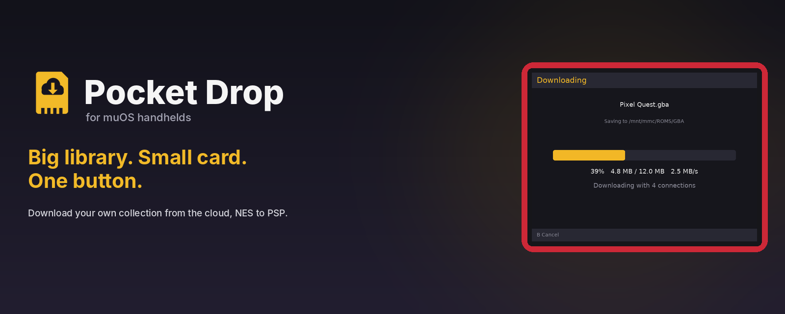
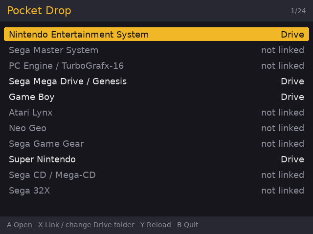
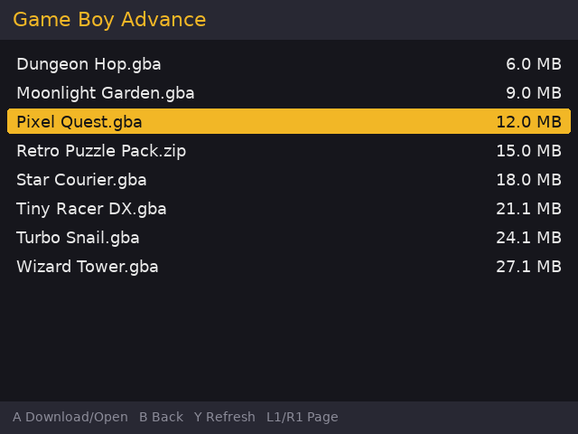
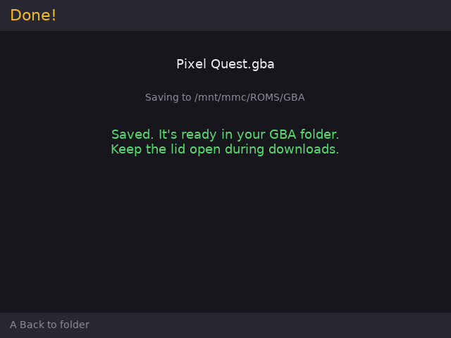

<div align="center">



# Pocket Drop

**Big library. Small card. One button.**

Pocket Drop turns your muOS handheld into a one-button download station for your own game collection.
Keep everything in the cloud and drop games onto your device only when you want to play them.

[](https://github.com/AlcaTechRetro/Pocket-Drop/releases/latest)
[-3a5282)](https://muos.dev)
[](#requirements)
[](LICENSE)

[**Download**](https://github.com/AlcaTechRetro/Pocket-Drop/releases/latest) ·
[Quick start](#quick-start) ·
[Features](#features) ·
[FAQ](#faq) ·
[Report a bug](https://github.com/AlcaTechRetro/Pocket-Drop/issues/new/choose)

</div>

---

## Why Pocket Drop?

Big SD cards are expensive, and most of a library sits unplayed.
Pocket Drop keeps your collection in **your own cloud storage** and brings a game to your handheld the moment you want it:
pick a console, press **A**, and it's downloaded, checked, unzipped and saved in the right folder, ready to play.
No PC, no cables, no copying files around.

| Pick a console | Pick a game | Press A | Play |
| :---: | :---: | :---: | :---: |
|  |  |  |  |

## Features

| | |
| --- | --- |
| 🎮 **22 consoles** | NES to PSP, each with its own source and its own `ROMS` folder |
| ☁️ **Your own cloud** | Google Drive today, with more source types on the way |
| ⚡ **Fast** | Up to 4 connections at once, plus a temporary CPU and Wi-Fi boost |
| ✅ **Safe** | Every file is MD5-checked, and failed or stopped downloads are cleaned up automatically |
| 📦 **Hands-off** | Unzips for you, saves to `ROMS/<console>` and creates every console folder on first start |
| 🛠️ **Easy setup** | Paste your links into one text file on your PC, or add them on the device with **X** |
| 🔋 **Self-contained** | The LÖVE engine is bundled, so there's nothing else to install |
| 📝 **Clear logs** | Readable `log.txt` with your API key hidden, safe to share when asking for help |

## Requirements

- A handheld running **muOS (MustardOS)**. Pocket Drop is developed and tested on the **Anbernic RG35XX SP**.
- Wi-Fi.
- A free **Google API key** and Google Drive folders shared as *Anyone with the link*. The [setup guide](docs/GOOGLE-DRIVE-SETUP.md) walks you through it in about 15 minutes.

## Quick start

1. **Download** `PocketDrop.zip` from the [latest release](https://github.com/AlcaTechRetro/Pocket-Drop/releases/latest).
2. **Unzip** it and copy the `PocketDrop` folder to `MUOS/application/` on SD card 1.
3. **Connect your cloud:** open `PocketDrop/drive_links.ini` on your PC and paste in your API key and one folder link per console:
   ```ini
   api_key = AIzaSy...your key...
   GBA = https://drive.google.com/drive/folders/....?usp=sharing
   ```
4. **Play:** on the handheld, open **Applications → Pocket Drop**, pick a console and press **A**.

New to API keys? Follow the step-by-step [Google Drive setup guide](docs/GOOGLE-DRIVE-SETUP.md).

## Controls

| Button | Action |
| :---: | --- |
| **A** | Open console / download game |
| **B** | Back / stop download (the partial file is deleted) |
| **X** | Link or change a console's source |
| **Y** | Refresh |
| **L1 / R1** | Page up / down |
| **Start + Select** | Quit |

## Supported consoles

| | | | |
| --- | --- | --- | --- |
| NES | Master System | PC Engine / TG-16 | Mega Drive / Genesis |
| Game Boy | Atari Lynx | Neo Geo | Game Gear |
| Super Nintendo | Sega CD / Mega-CD | Sega 32X | Sega Saturn |
| PlayStation | Virtual Boy | Nintendo 64 | Game Boy Color |
| Dreamcast | Neo Geo Pocket Color | WonderSwan Color | Game Boy Advance |
| Nintendo DS | PSP | | |

Whether a game runs well depends on your handheld and muOS's emulators. Pocket Drop only delivers the file.

## FAQ

<details>
<summary><b>Does Pocket Drop come with games?</b></summary>

No. Pocket Drop does not include, find or link to any games. It downloads files from sources **you** set up, such as your own Google Drive.
</details>

<details>
<summary><b>Is my Google API key safe?</b></summary>

The key stays on your SD card in `drive_links.ini` and is hidden in all logs. Restrict it to the Google Drive API in Google Cloud Console, and never upload a filled-in `drive_links.ini` anywhere public.
</details>

<details>
<summary><b>It says "download limit reached". What happened?</b></summary>

Google pauses a file after many downloads in a short time. It clears by itself, usually within 24 hours, and other files keep working.
</details>

<details>
<summary><b>Will it work on other handhelds?</b></summary>

It's built for muOS on 640×480 aarch64 devices. Other muOS handhelds should work but haven't been tested yet, so reports are welcome in [Issues](https://github.com/AlcaTechRetro/Pocket-Drop/issues).
</details>

<details>
<summary><b>Can I use sources other than Google Drive?</b></summary>

Support for other sources is in progress (see the [roadmap](#roadmap)).
</details>

## Roadmap

- [x] One-button downloads from Google Drive
- [x] Parallel downloads, MD5 check and auto-unzip
- [x] Automatic `ROMS` folders for 22 consoles
- [ ] More source types (web folders and other cloud storage)
- [ ] Search inside a console
- [ ] Download queue
- [ ] Testing on more muOS devices

## Contributing

Bug reports, device test results and pull requests are welcome. See [CONTRIBUTING.md](CONTRIBUTING.md).
When reporting a problem, please attach `log.txt` and `log-previous.txt` from the `PocketDrop` folder.

## Legal

Pocket Drop is a download tool. Use it only with files you have the legal right to use, such as backups of games you own.
It is not affiliated with muOS / MustardOS, Anbernic or Google.

## Credits

- Built with [LÖVE](https://love2d.org) 11.4, using the aarch64 build by Cebion. See [`PocketDrop/bin/LOVE-LICENSE.txt`](PocketDrop/bin/LOVE-LICENSE.txt).
- Made for the [muOS](https://muos.dev) community.
- Pocket Drop is released under the [MIT licence](LICENSE).

<div align="center">

**If Pocket Drop saves you an SD card upgrade, give it a ⭐**

</div>
