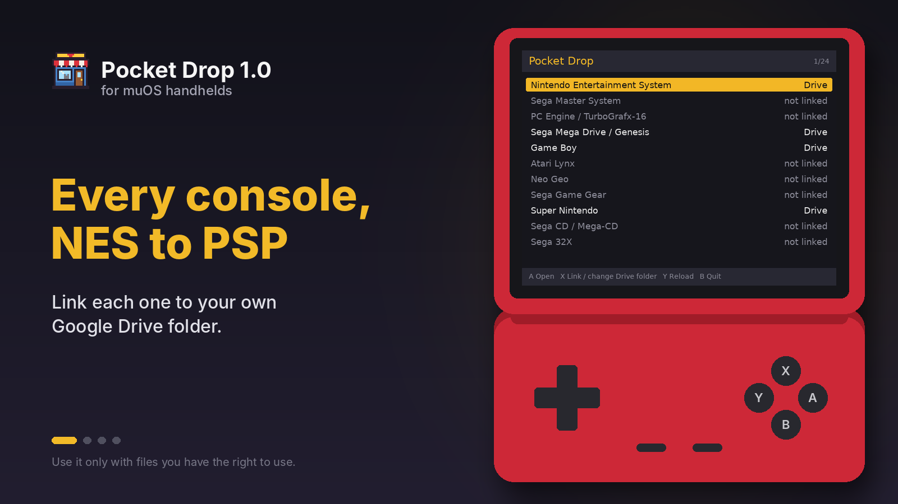
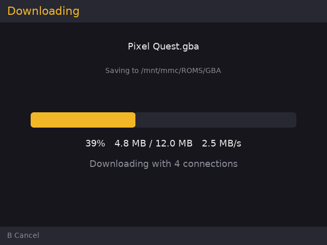

# Pocket Drop 🏪

**A one-button game downloader for muOS (MustardOS) handhelds.**
Link each console to a Google Drive folder of *your own* files, then pick a game and press **A**.
It downloads, checks itself and lands in the right `ROMS` folder, ready to play.

| Browse | Download | Done |
| --- | --- | --- |
|  |  |  |

## Features

- Consoles from NES to PSP, each linked to its own Google Drive folder
- Links set on your PC (`drive_links.ini`) or on the device (press **X**)
- Fast downloads: up to 4 connections at once, file checked with MD5
- Unzips automatically and saves straight to `ROMS/<console>`
- Failed or stopped downloads are cleaned up automatically
- Creates the `ROMS` folder for every console on first start
- LÖVE engine included, nothing else to install

Tested on the **Anbernic RG35XX SP** with muOS 2601.

## Install

1. Download `PocketDrop-1.0.zip` from [Releases](../../releases).
2. Unzip it and copy the `PocketDrop` folder to `MUOS/application/` on SD card 1.
3. Follow `PocketDrop/START-HERE.txt` to add your free Google API key and Drive links
   (full walkthrough in `PocketDrop/GOOGLE-DRIVE-SETUP.txt`).
4. On the handheld: **Applications → Pocket Drop**.

## Buttons

| Button | Action |
| --- | --- |
| A | Open console / download game |
| B | Back / stop download |
| X | Link or change a console's Drive folder |
| Y | Refresh |
| L1 / R1 | Page up / down |
| Start + Select | Quit |

## Important

Pocket Drop does not include, find or link to any games.
Only use it with files you have the legal right to use, such as backups of games you own.

## Credits

Built with [LÖVE](https://love2d.org) 11.4 (aarch64 build by Cebion). See `PocketDrop/bin/LOVE-LICENSE.txt`.
Pocket Drop itself is released under the MIT licence (see `LICENSE`).
